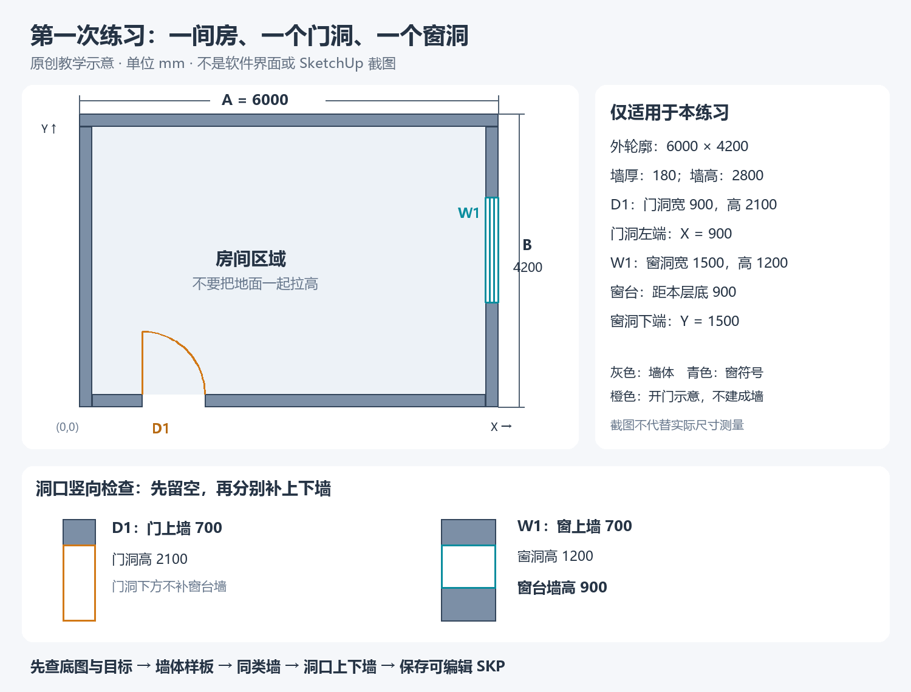

# 第一次练习：完成一层小白模

这是原创教学练习，不是真实项目、结构方案或施工图。下面尺寸只用于这次练习，不能带到你的其他项目。目标是走通底图准备、尺寸检查、墙体与洞口上下墙、保存可编辑 SKP；不自动做柱、屋顶、坡道或材质。

## 先拿到三个文件

- [练习原图 practice-source.dxf](../assets/practice/practice-source.dxf)：包含墙线、门窗符号和尺寸说明，从它开始。
- [清理参照 practice-clean-reference.dxf](../assets/practice/practice-clean-reference.dxf)：只用于对照你清理的副本，不要求学生跳过原图保留与清理步骤。
- [尺寸与洞口示意图](../assets/practice/plan-reference.png)：教学绘制，不是 CAD 菜单或实际 SU 模型截图。

提供 DXF 是为了让这份原创练习保持可编辑；本轮没有生成 DWG／SKP，也没有实机验证其 AutoCAD、天正或 SU 导入。DXF 可先在自己的 CAD 学习文件中打开并按原流程导出 DWG；不要把后缀直接改成 .dwg。

## 本练习尺寸依据

下表使用练习的局部坐标：外墙左下角为 (0,0)，X 向右、Y 向上，Z=0 为本层底基准，数值均为毫米。原始 DXF 在这个坐标绘制，没有其他楼层。CAD 复制到旁边、导入或在 SU 中移动后，世界坐标可能变化；AI 先读当前目标左下角、标高及实例变换，再把这些局部位置对应到现场，不能在世界原点另造一间房或强行移回原点。

| 内容 | 明确给定值 |
|---|---|
| 外墙外轮廓 | X=0…6000；Y=0…4200 |
| 墙厚、墙高 | 180；2800 |
| 室内净轮廓 | X=180…5820；Y=180…4020（5640×3840） |
| 南侧门洞 D1 | X=900…1800，Y=0…180；宽900，高2100，门洞底Z=0 |
| 东侧窗洞 W1 | X=5820…6000，Y=1500…3000；宽1500，高1200，窗台Z=900 |
| 门上墙 | Z=2100…2800，高700，平面覆盖 D1 |
| 窗台墙／窗上墙 | Z=0…900／2100…2800，高900／700，平面覆盖 W1 |

平面里门弧只是开门符号，窗双线是窗符号；不是墙体面。房间区域不是要统一拉高的墙。房间参照与部分墙内边、窗口边界与部分端线重合，导入可能合并共边，先检查实际线面，不按原文件实体数量决定封面成功。当前练习只要求准确表达洞口与上下墙，不要求制作门扇、窗框或玻璃。

## 第一步：连接并准备底图

没有连接就从 [安装与连接](install-connect.md) 开始，不因为拿到练习包就假装已接通。已连接则成功读到自己的练习文档后跳过安装。

在 CAD 中打开练习原图，先另存到你的学习目录，保留它作尺寸依据。把平面复制到原图旁边，只清理副本：去掉 ANNOTATION 的文字和尺寸辅助线；保留 WALL、DOOR_SYMBOL、WINDOW_SYMBOL，以及用于区分房间的 ROOM_REFERENCE。对照清理参照，但不要删除原图。

有天正时继续按“文件布图 → 局部导出”，只框选整理副本，空格确认，按本机核对后的天正3／AutoCAD2004／全部内容设置导出 DWG。没有天正时，用 CAD 自己的另存／导出把整理副本保存为普通 DWG，范围仍只含目标副本；天正不是必装依赖。版本差异按 [完整准备教程](cad-preparation.md) 核对。

新建独立的毫米 SU 准备文件，导入时核对 CAD 单位为毫米；按教程反复重选、炸开导入底图。原图有文字伸到轮廓之外，因此不能把整份文件包围盒当成外墙尺寸。

测外墙 X 两端，应为 6000；测外墙 Y 两端，应为 4200；另抽查墙厚180。测错先定位原因，不能仅凭 MCP units:mm 认定正确。封面时区分墙体、房间、门窗符号；水平面正面朝上。保存准备底图 SKP。

可以发：

> 使用 $cad-sketchup-mcp。我在做随包教学练习。请先确认连接和当前练习文档，核对外墙6000、4200与墙厚180，再检查墙线、房间区域和门窗符号。先只检查，不建模。

通过这一阶段：读到正确文档，两段尺寸与墙厚对应，底图必要区域可编辑、封面与朝向正确，SKP 已保存。

## 第二步：只建墙体

确认当前目标是这份练习底图，备份当前状态。先做一段厚180、高2800的墙体样板，实测正确后继续同类墙体；保留南侧 D1 与东侧 W1 的平面范围，别把房间地面、门弧或窗双线拉高。导入共边可能合并，不用“必须有六个面”判断完成。

> 只做当前练习的墙体。墙厚180、墙高2800，层底Z=0；保留D1和W1平面范围。先备份并做一段样板，展示实际尺寸检查；通过后继续本练习同类墙体。不要拉高房间、门弧或窗符号，不加其他构件。

自己看三件事：只改了练习文件吗？墙厚／高测对了吗？门窗位置和房间区域是否保留？保存墙体阶段 SKP 并看预览。

## 第三步：补洞口上下墙

> 继续当前练习，先重读现场并保留我的改动。D1门洞900×2100、底Z=0；W1窗洞1500×1200、窗台Z=900；总墙高2800。按表中位置补D1门上墙、W1窗台墙和窗上墙，不封死洞口，不造门扇、窗框或玻璃。先备份，检查后保存SKP和局部预览。

自己核对：D1 门上墙高700，门洞下不补窗台墙；W1 窗台墙高900、窗上墙高700，净开口高1200。从内外两侧看洞口是否贯通，检查不以截图替代尺寸读回。

## 最后，确认练习完成

- 外墙外轮廓6000×4200、墙厚180、墙高2800能实测复核。
- D1、W1的位置与净开口宽高、上下墙对应尺寸表。
- 房间没有误变成实体大墙，门弧和窗符号没有当墙拉高。
- 墙和洞口相关构件独立可编辑，原尺寸依据与阶段备份保留。
- 最终 SKP 确实保存、非空，并能继续编辑；需要重开文件时由学生在自己练习副本中核对，不关闭其他未保存文档。

只记录“卡在哪一步、实际发生什么、最后得到了什么”。完成练习不能说明真实项目或结构安全已经验证；本轮仅完成文件与静态几何检查，真实导入、建模和学生试用仍待验证。
