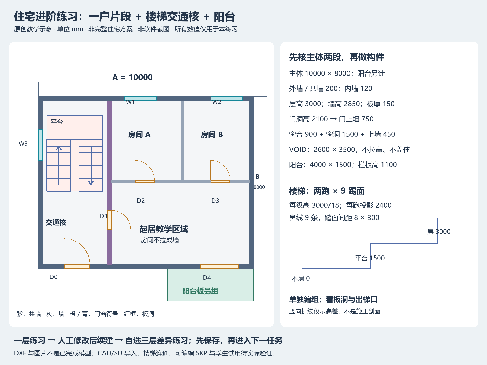

# 住宅进阶练习：一户片段＋楼梯＋阳台

原创、简化的几何教学数据，不是真实项目、完整户型、结构或合规方案。用来练构件分类、竖向关系、人工修改后续建及楼层差异，不评估厨卫配置、疏散、净高或结构安全。以下值只在学生明确选择本练习时使用。

- [原图 DXF](../assets/residential/residential-source.dxf)：保留作尺寸依据，包含说明文字。
- [清理参照 DXF](../assets/residential/residential-clean-reference.dxf)：只移除 ANNOTATION，对照清理副本。
- [平面与检查示意](../assets/residential/residential-reference.png)：教学图，非当时软件截图或已完成 SKP。

使用 [原 CAD → SU 准备流程](cad-preparation.md)：保留原图、清理旁边副本、有天正时局部导出、新建毫米 SU 文件、导入、反复重选炸开、测两段、封面检查、保存。DXF 需在自己的 CAD 学习文件中另存／导出 DWG，不能直接改后缀。本轮未做真实导入或生成 SKP。

## 已给定的练习依据

坐标单位 mm：建筑矩形左下角为 (0,0)，X 右、Y 上，本层地面顶为 Z=0。复制／移动后对应目标的局部坐标，不在世界原点重造。Y<0 的阳台不计入主体 10000×8000 控制尺寸。

| 项目 | 练习值 |
|---|---|
| 主体外轮廓 | X=0…10000，Y=0…8000；控制尺寸 A=10000、B=8000 |
| 外墙／交通核共墙 | 厚200；共墙 X=3200…3400，Y=200…7800，扣 D1 |
| 户内分隔 | 横墙 Y=4000…4120，X=3400…9800，扣 D2/D3；竖墙 X=6640…6760，Y=4120…7800；厚120 |
| 层高、墙高、楼板 | 层高3000；墙 Z=0…2850；本层板 Z=-150…0，厚150，上层板底2850 |
| 主体板与洞口 | 板平面为主体矩形，扣 VOID：X=400…3000、Y=3600…7100；相邻层共用板只保留一块 |
| 阳台板 | X=6000…10000，Y=-1500…0，Z=-150…0，与主体板边界相接不重叠 |
| 阳台栏板 | 三条外边：X=6000…6100、X=9900…10000（Y=-1500…0），及 Y=-1500…-1400（X=6100…9900）；Z=0…1100；临墙一边不加栏板 |

两上部房间与下部起居区域只是教学分区；不据此补全厨卫或家具。WALL_EXTERNAL、WALL_SHARED、WALL_INTERNAL 是墙；DOOR_SYMBOL、WINDOW_SYMBOL 是符号；SLAB_BOUNDARY、VOID、BALCONY、STAIR_SYMBOL 是不同用途的线，不能一起拉高。板边界即使封成大面也不证明板洞已扣除。

### 门窗表（净开口，含定位）

| 编号 | 平面范围 | 高与底标高 |
|---|---|---|
| D0 交通核南入口 | X=1200…2400，Y=0…200 | 宽1200，高2100，底0 |
| D1 入户 | X=3200…3400，Y=1800…2700 | 宽900，高2100，底0 |
| D2／D3 户内门 | X=4500…5400／8000…8900，Y=4000…4120 | 各宽900，高2100，底0 |
| D4 阳台推拉门 | X=7500…9300，Y=0…200 | 宽1800，高2100，底0；只表达洞口，不自动制门扇 |
| W1／W2 北窗 | X=4000…5500／8000…9500，Y=7800…8000 | 各宽1500，高1500，窗台900 |
| W3 交通核西窗 | X=0…200，Y=5000…6500 | 宽1500，高1500，窗台900 |

因此本练习门上墙高750，窗台墙高900、窗上墙高450。不能沿用入门练习的 2800 墙高或 700 上墙。窗边界不是封死墙；从内外两侧查净洞口。

### 楼梯表（本练习已明确允许简化实体）

层间高差3000，双跑各9个踢面，总18个；每个高3000/18，保留精度避免逐级取整累计。每跑8个踏面间距300，总水平投影2400；鼻线9条，不能按鼻线数再额外增加一个踏面间距。

- 第一跑 X=400…1500，向 +Y 上：9条鼻线 Y=3600+300×i，Z=(i+1)×3000/18，i=0…8。
- 中间平台 X=400…3000，Y=6000…7100，顶Z=1500、厚150。
- 第二跑 X=1900…3000，向 -Y 上：9条鼻线 Y=6000-300×i，Z=(10+i)×3000/18，i=0…8，最终Z=3000。
- 本层起步平台 X=400…3000，Y=2500…3600，顶Z=0，由本层板承担；上层同位置接顶Z=3000的上层板。

平面鼻线／箭头不是水平墙，也不包含高度；高度依据来自上表。允许用闭合踏步块与平台表达教学楼梯，不要求斜板、扶手或结构节点。楼梯整体独立于墙板，空隙 X=1500…1900 保留；只核总高、平台、投影和板洞关系，不声称安全通过。图层名 VOID 不能当成已经切除实体。

## 练习一：只做一层，按阶段保存

1. **底图与目标**：确认独立文件、局部坐标对应、主体 A/B 和墙厚；不以含标注或阳台的总 bbox 量主体。
2. **墙与洞口**：做一处样板后继续本层；分外墙200、共墙200、内墙120，补750门上墙及900／450窗上下墙。保存并测净洞口。
3. **楼板与阳台**：单独成组，扣 VOID；阳台三边栏板与 D4 分开。两板边界 Y=0 可相接，不能体积重叠。保存，检查门口与洞口。
4. **教学楼梯**：按表做双跑与平台；总升高3000、中间1500、水平投影2400。可见楼梯不等于贯通，检查上层板洞及出梯位置；未做上层板时标“上层接续未验证”。

> 使用 $cad-sketchup-mcp，选择随包住宅教学片段。请按 residential-practice.md 的练习值，先核对当前底图和主体10000、8000。这轮只做墙体与门窗洞口，保留现有位置和其他副本；样板通过后继续本层，暂不建楼梯、板或栏板。

下一阶段再明确“继续本练习楼板、阳台和教学楼梯”，不要一次默认推进所有内容。

## 练习二：三层差异，只在学生选择后进入

这是第二个独立任务，先保留一层成果与原始底图。用已验标准层建立三层教学副本：F1 Z=0，F2 Z=3000，F3 Z=6000；各层墙顶依次2850／5850／8850。各标高平移均相对本栋基准。

| 楼层 | 明确差异 |
|---|---|
| F1 首层 | 保留 D0 南入口；不建阳台板／栏板；D4 原范围改为与 W1 同高、同窗台的窗洞（宽仍1800）；只建向 F2 的楼梯，不建向下跑 |
| F2 标准层 | D0 以同厚实墙填至本层墙顶；其余按原一层练习；保留阳台及向 F3 楼梯 |
| F3 顶层 | D0 同 F2；保留阳台；本层有到达平台，不建向上的楼梯。顶盖板 X=0…10000、Y=0…8000，Z=8850…9000，不开 VOID，不复制阳台到屋面 |

层板分别 Z=-150…0、2850…3000、5850…6000；后两块扣同一 VOID。首层板也按教学原图留 VOID（仅作几何练习，不据此设计基础）；不补地下层。顶盖是已给定的简化平板，不加女儿墙、排水或坡度。不得用本练习替真实屋面设计。

先隔离需要改变的共享定义，再在副本上落实差异。成栋后按三层分别看入口、阳台、窗洞、板洞、楼梯方向和顶层终止；主体墙与顶盖总高9000，本练习三层共两段层间楼梯，不是每层都向上再复制一段。按层可独立选择和编辑。

## 人工续建试走与实际记录

完成一层后，学生可在测试副本中移动整个目标层，再炸开一个窗墙子组，保留这些人工改动。给 AI 最新位置／选择和一处明确补洞口任务；开始前重新读取，结束后测目标位置、洞口及受保护副本。人工操作、前后相同视角图片、回读和 SKP 都有证据时才记为实机通过。此处是待执行的教学任务，不是已经完成的实验。

记录六件事即可：环境与 MCP 两端版本、从哪阶段开始、实际完成内容、关键测量、卡点／人工协助、当前 SKP 与预览。新增练习当前仅做静态资产检查和文本桌面推演；真实 CAD/SU 导入、楼梯连通、保存重开及学生试用待验证。
